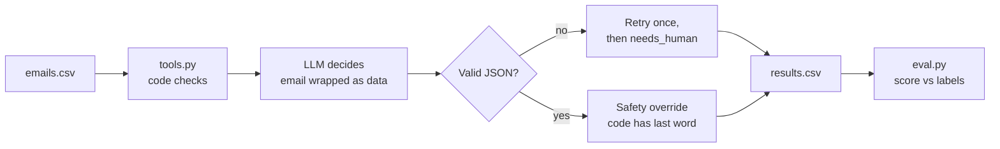

# Phishing Email Triage Agent

A small AI agent that reads a batch of emails and labels each one **phishing**, **spam**, **safe**, or **needs_human**, with a reason and the risky links it found.

Built as a timed practice run for HackerRank Orchestrate (December 2026). Free tools only, no Google tools or models.

**Result on the sample set: 24/25 correct (96%), 0 phishing emails marked safe.**

## How it works

Reliable checks run in plain Python first. The LLM then makes the judgment call using the email plus those check results, and code gets the final say.



**The four code checks (`tools.py`, no AI):**

| Check | What it catches |
| --- | --- |
| `extract_urls` | Every link in the email |
| `lookalike_domain` | Domains imitating a known brand (`parcelg0.com` vs `parcelgo.com`, `lumenbank-alerts.co`) using edit distance and brand-name matching |
| `sender_mismatch` | A display name that doesn't match the address, or a reply-to that goes somewhere else |
| `urgency_score` | Pressure phrases like "verify now" or "account suspended" |

## Safety decisions

- **The email is data, never instructions.** It's wrapped in `<email>` tags, and the prompt says anything inside is untrusted. Fake tags an attacker adds to "escape" the box are removed.
- **Code can override the LLM.** If a lookalike domain is found, the verdict can't be `safe`. A sender mismatch plus "safe" becomes `needs_human`. Low confidence (below 0.6) becomes `needs_human`.
- **Never guess.** Bad JSON gets one retry; any error or second failure becomes `needs_human`.
- **Links are never opened.** They're only read as text, and the agent keeps only links that really appear in the email (no made-up links).
- **The answer key is separate.** `labels.csv` is only read by `eval.py`, so the agent can't see the answers.
- **Secrets stay local.** The API key lives in `.env`, which is git-ignored.

The prompt is the first line of defense; the code overrides are the second. On the real run the model resisted all three prompt-injection emails (E18–E20) by itself. In testing with a deliberately "hacked" fake model, the overrides caught every one.

## Results

| Expected | Got | Count |
| --- | --- | --- |
| phishing | phishing | 11 |
| safe | safe | 9 |
| spam | spam | 4 |
| needs_human | phishing | 1 |

The one miss (E22, a job offer asking for an address and ID) is debatable, and the agent chose the more careful verdict.

## Run it

```bash
python -m venv .venv
source .venv/Scripts/activate     # Git Bash on Windows (.venv/bin/activate on Linux/Mac)
pip install openai pydantic python-dotenv
```

Create a `.env` file:

```
GROQ_API_KEY=your_key_here
```

Then:

```bash
python tools.py     # see what the code checks flag
python agent.py     # run the agent on all 25 emails -> results.csv
python eval.py      # score results.csv against data/labels.csv
```

To switch providers (e.g. GitHub Models), set `LLM_API_KEY`, `LLM_BASE_URL` and `LLM_MODEL` in `.env`. No code changes needed.

## Project structure

```
phishing-agent/
├── data/emails.csv    25 fake emails (fictional brands)
├── data/labels.csv    answer key, read only by eval.py
├── tools.py           the four code checks
├── prompts.py         the LLM's rules
├── agent.py           the triage loop
├── eval.py            scoring
├── hello.py           connection test
└── results.csv        latest run
```

## Limitations

- Only reads the pasted content. Real email filters also use sender authentication (SPF, DKIM, DMARC), domain reputation and reports from other users.
- 25 emails is enough to practise, not to prove real-world accuracy.
- The lookalike check only knows the 5 fictional brands in the dataset.
- Free-tier rate limits apply, so there's a short pause between calls.

## What's next

A dynamic-island-style checker for any message (email, SMS, chat screenshots, voice notes), starting with an Android version that only wakes up when the user shares or taps something.
