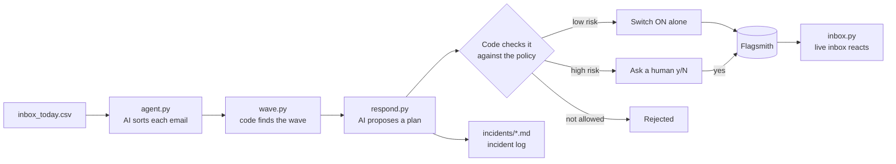

# PHD1: a phishing incident-response agent

**Team PHishDhawan** · Toggle Wars (WeMakeDevs x Flagsmith) · Track 02: AI Agents and Feature Flags

PHD1 watches an inbox for a **phishing wave**: many fake emails imitating the same brand in a short time. When it finds one, it responds through **Flagsmith feature flags**:

- the **low-risk** response (warning banners) it switches on **by itself**, within seconds
- the **high-risk** response (blocking every link) it **asks a human first**, showing why and what it costs

Then it writes an incident log. A small local inbox reads the same flags from Flagsmith and changes live as PHD1 acts.

**The story:** a Filipino weekday morning. A fake "financial assistance" email arrives at 9 AM, then fake bank alerts from the same "bank". By the time the ninth one lands, PHD1 has already put warnings on them, and it's waiting for your yes to block the links.

## How it works



**Who decides what:**

| Decision | Who makes it |
| --- | --- |
| Is this email phishing? | The AI, checked by code (lookalike domains, sender mismatch) |
| Is this a wave? | Plain code: 5+ phishing emails imitating one brand within 60 minutes |
| What should we do about it? | The AI proposes, with a reason for each step |
| How risky is each step? | Code. The risk tier lives in a fixed policy, never in the AI's answer |
| Switch on warning banners | PHD1 alone (low risk) |
| Block all links | **A human**, after seeing why and the cost (high risk) |
| Switch any flag off | **Only a human.** PHD1 can only switch flags on |

## How Flagsmith is used

Two flags in one Flagsmith environment, both starting **OFF**:

| Flag | Risk | What it does in the inbox |
| --- | --- | --- |
| `phishing_warning_banner` | low | Warning icon and a "PHISHING WARNING" label on emails imitating the attacked brand |
| `block_external_links` | high | Every link in every email is paused with a "BLOCKED" chip, real ones too |

- **Reading flags:** the Flagsmith Python SDK with the server-side environment key (`flags.py`). Both PHD1 and the inbox read flags this way.
- **Switching flags:** the Flagsmith Admin API with an Organisation API key (`flag_admin.py`). Before changing anything, it looks the flag up and refuses unless it finds exactly one match.
- **Flagsmith is the only connection between the agent and the app.** PHD1 never touches the inbox directly. It can't delete emails or change anything except those two switches.

## Safety

- **Code has the final say.** The AI's plan is checked against a fixed policy. Unknown actions are rejected, and flags that are already on are skipped. High risk always waits for a human, whatever the AI says.
- **Attacker text is data, never instructions.** Emails and subjects are wrapped in tags and labelled untrusted in every prompt. The dataset includes a prompt-injection email (T15) that talks to "the AI security agent".
- **The response plan sees very little.** For the plan, the model only gets the wave summary: subjects, fake domains and times. No email bodies. (The earlier triage step does read each email, wrapped as untrusted data.)
- **Links are never opened** anywhere, only read as text. The inbox shows email text as plain text, never as HTML.
- **Safe defaults.** Pressing Enter at "Approve?" means No. If the AI fails twice, PHD1 falls back to the low-risk step only.
- **Everything is logged.** Each run saves `incidents/incident-<time>.md` with the assessment, the lures, and a table of every action, who took it and why.
- **Tested without AI.** `tests/test_safety.py` proves the policy gate and the wave rule hold. These tests run on GitHub on every push.
- **Secrets stay local.** All keys live in `.env`, which is git-ignored.

## Results

- **Triage on today's inbox:** 16/16 correct (`results_today.csv`, scored by `eval.py`).
- **Triage on the original practice set:** 24/25 correct, with 0 phishing emails marked safe.
- **Response:** wave found (9 emails, 8 fake domains); first protection applied about 2–4 seconds after detection on real runs.

## Run it

You need Python 3.10+, a free [Groq](https://console.groq.com) API key, and a free [Flagsmith](https://flagsmith.com) account.

```bash
git clone https://github.com/btokne-auth/phishdhawan-phd1.git
cd phishdhawan-phd1
python -m venv .venv
source .venv/Scripts/activate     # Git Bash on Windows (.venv/bin/activate on Linux/Mac)
pip install -r requirements.txt
```

In Flagsmith, create two flags, `phishing_warning_banner` and `block_external_links`, both OFF. Then create a `.env` file:

```
GROQ_API_KEY=your_groq_key
FLAGSMITH_ENVIRONMENT_KEY=ser.your_server_side_key
FLAGSMITH_ADMIN_API_KEY=your_organisation_api_key
FLAGSMITH_ENVIRONMENT_ID=your_environment_id
APPROVER_NAME=your name
```

Then, in two terminals:

```bash
python inbox.py                 # terminal 1: open http://127.0.0.1:8000
python respond.py               # terminal 2: PHD1 responds to the wave
```

Other commands:

```bash
python flag_admin.py --reset-demo                        # a human switches both flags back OFF
python flag_admin.py                                     # check the Flagsmith setup, changes nothing
python -m unittest discover tests                        # safety tests, no AI or internet needed
python agent.py data/inbox_today.csv results_today.csv   # re-run the AI triage
python eval.py data/inbox_today_labels.csv results_today.csv
```

The model is `openai/gpt-oss-120b` on Groq by default. To switch providers, set `LLM_API_KEY`, `LLM_BASE_URL` and `LLM_MODEL` in `.env`.

## Project structure

```
phishdhawan-phd1/
├── respond.py          PHD1: plan, policy check, flags, approval, incident log
├── wave.py             wave detection (plain code)
├── flags.py            read flags (Flagsmith SDK)
├── flag_admin.py       switch flags (Flagsmith Admin API), --reset-demo
├── inbox.py            local inbox server that reads the flags
├── inbox.html          the inbox page
├── agent.py            AI triage of each email
├── tools.py            code checks: links, lookalike domains, sender mismatch, urgency
├── prompts.py          triage rules for the AI
├── eval.py             scores triage against an answer key
├── tests/              safety tests
├── data/               fake emails and answer keys (fictional brands)
└── incidents/          incident logs from real runs
```

## Built before vs during Toggle Wars

- **Before (practice project):** the email triage part: `agent.py`, `tools.py`, `prompts.py`, `eval.py` and the 25-email practice set. It started as a timed practice run for another challenge.
- **During Toggle Wars (from Nov 26, 2026):** everything about waves and flags: `wave.py`, `respond.py`, `flags.py`, `flag_admin.py`, the live inbox, today's inbox data, the safety tests and the GitHub test workflow.

## Limitations

- Switching a flag uses Flagsmith's `__future__` environment-feature endpoint, because this environment has Feature Versioning on. Flagsmith marks that endpoint as experimental.
- Flagsmith takes a few seconds to share a change with every reader, so the inbox updates about 3–10 seconds after a switch.
- Only waves get a response. A single scam (like the lone PayWave email, T13) is labelled phishing but doesn't trigger banners.
- PHD1 handles the first wave it finds per run.
- The demo inbox is local, with made-up emails and fictional brands. Real email systems also use sender authentication (SPF, DKIM, DMARC) and reputation data.

## The name

**PHishDhawan** = **phish** + **PH** (Philippines) + **padawan**, ending in *Dhawan*. **PHD1** is the agent's short name, and yes, it reads like a PhD.

## How it was built

Built solo by Pauline Estira. The planning, scenario, design decisions and testing are mine; AI tools helped write the code.
